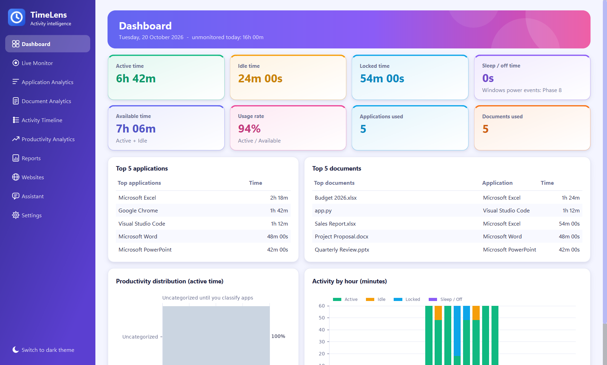
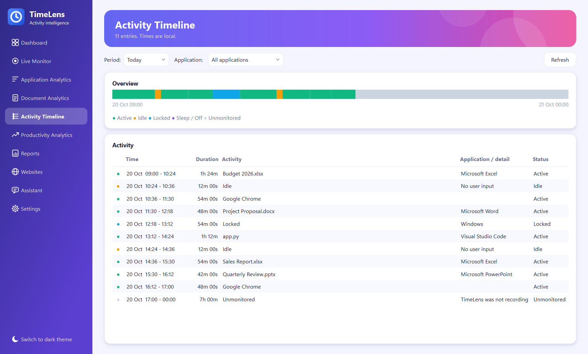
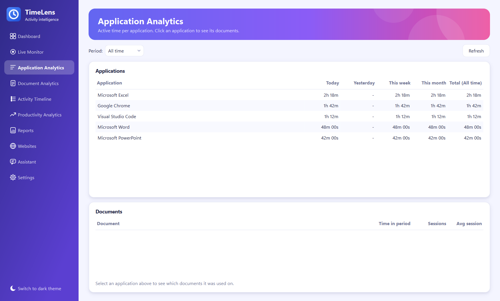

# TimeLens

An offline Windows app that shows how you use your computer: which applications and
documents you work in, for how long, and how much time the computer is idle, locked, asleep or
unmonitored. Everything is stored in a local SQLite database. There is no internet use, no
cloud, no screenshots and no keystroke logging.

## Screenshots

Screenshots use demo data only.







## Run it

Double-click **`Start TimeLens.bat`**, or use the packaged `dist\TimeLens\TimeLens.exe`
(see "Build the EXE").

* Closing the window hides TimeLens to the tray icon and it keeps monitoring.
* To stop it completely: right-click the tray icon > **Exit TimeLens**.
* Settings > Startup chooses "start with Windows" or "manual launch only".

Your data is in `%LOCALAPPDATA%\TimeLens` (database `timelens.db`, `logs`, `backups`).
Tray > **Open Data Folder** opens it.

## How it works (in five steps)

1. **tracker/** samples the foreground window every 2 seconds (`window_detector`), works out the
   document name from the window title (`document_detector`), and checks keyboard/mouse idle
   time (`idle_detector`) and lock state (`lock_detector`).
2. **tracker/session_manager.py** is a small state machine that turns those samples into
   non-overlapping *sessions* (Active / Idle / Locked / Sleep-Off / Unmonitored). It contains
   all the time rules and has no Windows code, so it is fully unit-tested.
3. **tracker/power_monitor.py** receives exact lock / unlock / sleep / wake / shutdown events
   from Windows.
4. **database/** stores sessions in SQLite (UTC timestamps, migrations, crash recovery).
5. **analytics/**, **ui/** and **exports/** read the database to build the dashboard, analytics
   pages, timeline, productivity view, and Excel/PDF reports.

## The Assistant (chat window)

The **Assistant** page lets you type what you want and it finds or opens your files:

* `open October Payroll.xlsx`, `open my latest pdf`, `find invoices in downloads`
* `show my recent excel files`, `where is the bank reconciliation file`
* `what did I work on today / yesterday / this week` (from your recorded activity)

How it works and its limits, honestly:

* It is **offline and rule-based**: no AI model and no internet. It understands the request
  styles in `help`, not free conversation. Spelling mistakes and plurals are tolerated.
* It searches Desktop, Documents, Downloads and OneDrive (change them with the **Folders**
  button). The file list is built in memory when you open the page; **file paths are never
  written to the database** and the chat is never saved.
* **It opens documents, images, audio and video, folders, and your installed apps by name**
  (`open chrome`, `open excel`, `launch calculator`). Apps come only from your Start Menu
  list plus a few fixed Windows tools (Notepad, Calculator, Paint, Settings ...); a program is
  never started from a typed path, and command-line / admin tools (Command Prompt, PowerShell,
  Terminal, Registry Editor, Python shells, Event Viewer ...) are refused. Scripts and programs
  as files (.exe, .bat, .ps1, .vbs, .lnk, .html ...) are refused too, including tricks like
  `invoice.pdf.exe`.
* **Most-used folders:** `show my most used folders` (also shown automatically when the page
  opens). TimeLens does not store file locations, so it finds the documents you worked on
  recently, looks up where they live (in memory), and adds up the time per folder.
* On a short window every page scrolls instead of squeezing its content.
* A search only lists results. A file opens only when you ask to open it or click **Open**. If
  several files match, it asks which one instead of guessing.

## Folder map

| Folder / file | What it is |
|---|---|
| `main.py` | Starts the app (`--background`, `--selftest`, `--run`, `--summary`, `--diagnose`) |
| `config.py` | Defaults and paths |
| `tracker/` | Window, document, idle, lock detection; session rules; power events; engine |
| `database/` | SQLite access, schema migrations |
| `analytics/` | All calculations (time totals, reports, productivity, timeline) |
| `ui/` | The PySide6 pages and widgets |
| `exports/` | Excel and PDF report writers |
| `assistant/` | The chat assistant: request parser, in-memory file index, safety rules, engine |
| `services/` | Startup shortcut, tray icon, backup/restore, single-instance lock |
| `tests/` | Automated tests (see `docs/TESTING.md`) |
| `TimeLens.spec`, `build_exe.bat` | Build the standalone EXE |

## Time definitions

* **Active**: awake, unlocked, input within the idle threshold (default 5 min, configurable).
* **Idle**: awake, unlocked, no input for longer than the threshold. It starts exactly when the
  threshold is reached.
* **Locked**: the Windows session is locked (takes priority over idle).
* **Sleep / Off**: sleeping, hibernating or shut down.
* **Unmonitored**: TimeLens was not running or could not tell.
* **Available** = Active + Idle. **Usage rate** = Active / Available x 100.

Every report checks that these five add up to the length of the period.

## Privacy

Stored: application name, executable file name, document *file name* (from the window title),
start/end times. Never stored: file paths, document contents, screenshots, typed text.
Web-browser window titles are not stored. **Website tracking is optional and OFF by default** (see below). You can exclude applications, delete history by date
or application, and back up / restore the database (Settings).

## Website tracking (optional, off by default)

Turn it on in **Settings > Websites** (or from the **Websites** page); a prompt explains it first and
lets you start from now or include the past 30 days.

* **Where it comes from:** the history file Chrome and Edge already keep. TimeLens copies it to a
  temporary file, reads the copy, and deletes it - it never changes your browser's files.
* **What is stored:** the site (for example github.com), the page title, the words typed into a
  search engine, and when/how long. **Not stored:** full web addresses, page contents, passwords,
  or private/incognito browsing (browsers do not put incognito visits in their history).
* **Profiles:** a browser can hold several people's profiles, so only each browser's **Default**
  profile is read until you tick others in Settings.
* **Controls:** exclude sites (their stored visits are removed too), turn off any time, delete all
  website history; the date-range delete in Settings covers website visits as well.
* **Limits:** "time open" is what the browser reports per visit (capped at 1 hour each); it is
  not the same as time you actively used the page.

## Build the EXE

Double-click **`build_exe.bat`**. It installs PyInstaller, builds `dist\TimeLens\TimeLens.exe`,
and runs the built-in self-test on the result. Why a *folder* and not a single file: a
single-file EXE unpacks itself on every launch (slow start for an app that starts with Windows)
and is flagged by antivirus programs more often. Zip the `dist\TimeLens` folder to share it.

`TimeLens.exe --selftest result.txt` checks every part of the app in a temporary folder and
never touches your real data.

## Developer notes

```
python -m venv .venv
.venv\Scripts\python -m pip install -r requirements.txt
.venv\Scripts\python -m pytest -q
```
